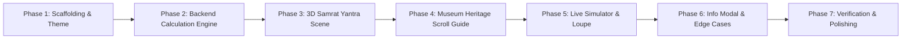

# KalaGanaka — Project Implementation Plan
**Interactive Indian Timekeeping & Astronomy Lab**  
*Module 1: Samrat Yantra Live Solar-Time Simulator*

---

## 1. Executive Summary & Vision

**KalaGanaka** is a museum-quality, physically accurate educational web application that bridges traditional Indian astronomical heritage with modern celestial mechanics.

The cornerstone module is the **Samrat Yantra Live Solar-Time Simulator**, an interactive digital twin of the world's largest stone sundial (the Brihat Samrat Yantra at Jantar Mantar, Jaipur, built by Maharaja Sawai Jai Singh II in 1734 CE). The platform enables any user worldwide to:
1. Walk through a scroll-driven **Museum Heritage Guide** explaining the geometry, history, and physics of equinoctial sundials.
2. Enter an interactive **3D Architectural Simulator** that dynamically orients its gnomon to the user's local latitude or chosen global location.
3. Compute physically authentic solar coordinates (altitude, azimuth, declination) via a Python/FastAPI astronomical engine.
4. Cast real geometry-based 3D shadows across curved marble quadrant scales graduated to 6-second increments.
5. Inspect the exact shadow edge via a **Shadow Reading Loupe** and compare **Local Apparent Solar Time** against **Modern Civil Clock Time** (explaining longitude offset, standard time zones, and the Equation of Time).

---

## 2. System Architecture

```mermaid
flowchart TD
    subgraph Frontend ["Frontend (React 18 + Vite + JavaScript/JSX)"]
        UI["Museum Heritage UI<br/>(Tailwind CSS + Serif Aesthetics)"]
        Scroll["Scroll Guide<br/>(GSAP ScrollTrigger + Lenis)"]
        Scene["3D Canvas (R3F + Three.js + Drei)<br/>- Dynamic Gnomon & Quadrants<br/>- PBR Sandstone & Marble<br/>- PCF Soft Shadow Mapping"]
        Loupe["Shadow Reading Loupe<br/>(Sub-quadrant zoom down to 6s ticks)"]
        Store["State Store (Zustand)<br/>Coordinates, Time, Speed, Mode"]
    end

    subgraph Backend ["Backend (FastAPI + Python 3.11+)"]
        API["FastAPI Endpoints<br/>/solar-position, /batch, /places/search"]
        Astro["astronomy-engine Core<br/>Solar Altitude, Azimuth, Declination, Julian Date"]
        YantraGeo["Yantra Geometry Engine<br/>Hour Angle H -> Quadrant Angle & 6s Reading"]
        TimeEngine["Solar Time Engine<br/>Equation of Time, LAT, Ghatis/Palas"]
        Cache["In-Memory LRU Cache"]
    end

    UI --> Store
    Scroll --> Store
    Store <--> Scene
    Scene --> Loupe
    Store <-->|HTTP / REST (JSON)| API
    API --> Astro
    API --> YantraGeo
    API --> TimeEngine
    API --> Cache
```

---

## 3. Tech Stack Matrix

| Layer | Technologies | Purpose |
| :--- | :--- | :--- |
| **Frontend Framework** | React 18+, Vite, JavaScript (JSX) | Modern, high-performance reactive frontend |
| **Styling & Theme** | Tailwind CSS, Custom Heritage Tokens | Warm ivory, terracotta, muted gold, aged paper styling |
| **Typography** | Cormorant Garamond, Cinzel, Noto Serif Devanagari, Plus Jakarta Sans | Museum plaque serif aesthetics paired with crisp tabular data |
| **3D Rendering** | React Three Fiber (R3F), Three.js, `@react-three/drei` | Architectural digital twin, PBR shaders, real shadow casting |
| **Scroll Storytelling**| GSAP, ScrollTrigger, Lenis | Smooth inertia scroll & camera-guided museum walk |
| **State Management** | Zustand | Single source of UI, time, and simulation state |
| **Backend API** | FastAPI, Uvicorn, Pydantic v2 | High-throughput, typed REST API |
| **Astronomical Math** | `astronomy-engine`, `pytz` | Rigorous, non-approximated solar positions & Julian dates |
| **Geocoding** | OpenStreetMap Nominatim (`httpx`) | Worldwide city and coordinate resolution |
| **Testing** | `pytest`, `httpx` (backend), Vitest (frontend) | Verifying solar coordinates against Jaipur benchmarks |

---

## 4. Astronomical & Geometrical Calculations Specification

### 4.1 Solar Position Pipeline
1. **Time Conversion**: Convert user input $(Year, Month, Day, Hour, Minute, Second)$ in local IANA timezone to UTC ISO 8601, then to **Julian Date ($JD$)**.
2. **Equatorial Coordinates**: Use `astronomy-engine` to calculate the Sun's Right Ascension ($\alpha$), Declination ($\delta$), and Earth-Sun distance.
3. **Horizontal Coordinates**: For observer latitude $\phi$ and longitude $\lambda$, compute Topocentric Solar Altitude ($a$) and Solar Azimuth ($A$, where $0^\circ = \text{North}, 90^\circ = \text{East}, 180^\circ = \text{South}, 270^\circ = \text{West}$).

### 4.2 Equation of Time & Local Solar Time
- **Greenwich Mean Sidereal Time (GMST)** & Local Sidereal Time ($LST$).
- **Equation of Time ($EoT$)**:
  $$EoT = \text{Local Apparent Solar Time (LAST)} - \text{Local Mean Solar Time (LMST)}$$
- **Longitude Correction**:
  $$\Delta t_{\lambda} = 4 \times (\lambda_{\text{observer}} - \lambda_{\text{standard}}) \text{ minutes}$$
- **Civil Time vs Solar Time Relationship**:
  $$\text{Clock Time} - \text{Solar Time} = -\Delta t_{\lambda} - EoT$$

### 4.3 Samrat Yantra Instrument Geometry
- **Gnomon Inclination**: The hypotenuse of the gnomon is tilted at an angle equal to observer latitude $\phi$, aligned precisely along the North-South meridian line, pointing toward the celestial pole.
- **Equatorial Quadrants**: The twin quadrant arcs are circular cylinders inclined parallel to Earth's equatorial plane (tilted at $90^\circ - \phi$ from horizontal).
- **Solar Hour Angle ($H$)**:
  $$H = 15^\circ \times (T_{\text{solar\_hours}} - 12)$$
  - Morning ($H < 0$): Shadow falls on **Eastern Quadrant** (reading 6 AM to 12 Noon).
  - Solar Noon ($H = 0$): Shadow touches the gnomon base / center noon line.
  - Afternoon ($H > 0$): Shadow falls on **Western Quadrant** (reading 12 Noon to 6 PM).
- **Quadrant Scale Angle**: The shadow position along the quadrant arc is directly proportional to $H$ ($15^\circ$ per hour, $1^\circ$ per 4 minutes, $0.25^\circ$ per minute, $0.025^\circ$ per 6 seconds).
- **Scale Graduation & Uncertainty**:
  - Main graduations: Hours (1 to 6 on each wing)
  - Subdivisions: 15-minute, 5-minute, 1-minute, and 6-second ticks.
  - Measurement uncertainty: $\pm 3$ seconds at Jaipur Brihat scale (27 m gnomon height, where shadow moves $\approx 4\text{ mm/min}$).

### 4.4 Traditional Indian Units of Time
- $1 \text{ Solar Day (Ahoratra)} = 60 \text{ Ghatis (घटी)} = 24 \text{ hours}$
- $1 \text{ Ghati} = 60 \text{ Palas (पल)} = 24 \text{ minutes}$
- $1 \text{ Pala} = 60 \text{ Vipalas (विपल)} = 24 \text{ seconds}$
- $1 \text{ Vipala} = 0.4 \text{ seconds}$

---

## 5. Detailed Task Breakdown & Implementation Order



### Phase 1: Project Scaffolding & Museum Heritage Theme
- [x] **Task 1.1**: Initialize monorepo structure (`frontend/`, `backend/`, `docs/`).
- [x] **Task 1.2**: Create FastAPI backend skeleton with Python dependencies (`astronomy-engine`, `fastapi`, `uvicorn`, `pydantic`, `httpx`, `pytest`).
- [x] **Task 1.3**: Create Vite + React 18+ + JavaScript (JSX) frontend with Tailwind CSS, Lucide icons, Zustand, GSAP, and Three.js dependencies.
- [x] **Task 1.4**: Define Museum Heritage design tokens (warm ivory `#FBF7F0`, deep charcoal `#2A2421`, Jaipur terracotta `#C45138`, antique brass `#C5A059`, serif typography, museum plaque cards, gold divider rules).

### Phase 2: Astronomical Backend Engine & API
- [x] **Task 2.1**: Implement `core/astronomy.py` using `astronomy-engine` for exact solar coordinates $(a, A, \delta, JD)$.
- [x] **Task 2.2**: Implement `core/solar_time.py` for Equation of Time, LAST, longitude corrections, and traditional Indian units (Ghati, Pala, Vipala).
- [x] **Task 2.3**: Implement `core/yantra_geometry.py` mapping solar hour angle to quadrant arc angles, quadrant side (East/West), and 6-second scale readouts.
- [x] **Task 2.4**: Implement FastAPI endpoints:
  - `GET /health`
  - `POST /api/v1/solar-position` (single point with full astronomical + yantra metrics)
  - `POST /api/v1/solar-position/batch` (daytime time-lapse interpolation)
  - `GET /api/v1/places/search` (Nominatim search with in-memory caching)
- [x] **Task 2.5**: Write `pytest` test suite verifying Jaipur equinox noon ($H=0$, shadow on noon line) and winter/summer solstice bounds.

### Phase 3: 3D Samrat Yantra Architectural Scene & Real Shadows
- [x] **Task 3.1**: Setup React Three Fiber canvas with ACES Filmic tone mapping, PCF soft shadows, and orbit controls.
- [x] **Task 3.2**: Build procedural architectural 3D Samrat Yantra component:
  - Sandstone triangular gnomon with parametric tilt matching observer latitude $\phi$.
  - Central staircase steps along the hypotenuse gnomon ramp.
  - Top octagonal chhatri (traditional Rajasthani pavilion with cupola dome and columns).
  - Two curved white marble quadrant scales flanking East and West, tilted perpendicular to gnomon.
  - High-resolution quadrant scale textures with hour, minute, and 6-second ticks.
  - Courtyard paving with North-South-East-West directional markers.
- [x] **Task 3.3**: Directional Sun Light engine:
  - Calculate 3D Cartesian coordinates $(x, y, z)$ from astronomical altitude and azimuth.
  - Cast real, physically authentic geometry shadows from gnomon onto quadrant marble surfaces.
  - Dynamic sky illumination: daylight, warm golden hour, and twilight/night transitions.
- [x] **Task 3.4**: Visual overlays:
  - Dashed gold celestial pole axis line.
  - 3D Sun Path arc across the sky dome.
  - 3D Compass rose.
  - Camera preset viewpoints (Visitor, Aerial, Instrument, Gnomon, Cinematic Orbit).

### Phase 4: Museum Heritage Scroll Guide
- [x] **Task 4.1**: Setup smooth scroll framework (Lenis + GSAP ScrollTrigger).
- [x] **Task 4.2**: Implement 10 storytelling exhibits:
  1. *Entrance*: KalaGanaka title, Devanagari invocation, gold divider, scroll prompt.
  2. *What is KalaGanaka?*: Philosophy and 3 pillars (Location, Sun, Shadow).
  3. *Enter Jantar Mantar*: Sawai Jai Singh II and 18th-century observatory heritage.
  4. *Meet the Samrat Yantra*: Anatomical breakdown of the supreme instrument.
  5. *The Gnomon (शंकु)*: Axis alignment and latitude-dependent inclination.
  6. *The Quadrants (फलक)*: Equatorial plane geometry and 6-second precision.
  7. *The Shadow (छाया)*: Visualizing the shadow sweep across the day.
  8. *Reading Time*: Magnified loupe introduction and error bounds.
  9. *Sundial vs Clock*: Solar time vs civil standard time comparison.
  10. *Enter Live Simulator*: Smooth camera fly-in into the interactive 3D laboratory.

### Phase 5: Live Simulator Interface, State Store & Loupe
- [x] **Task 5.1**: Zustand state store (`useKalaStore.js`) connecting location, time, live mode, speed, and calculations.
- [x] **Task 5.2**: Left Control Panel:
  - Location search & preset chips (Jaipur, Delhi, Ujjain, Varanasi, Kolar).
  - Coordinates input & "Use My Location" browser geolocation.
  - Date & time pickers, Live Clock toggle, manual scrubber slider.
  - Simulation speed controls (1x, 60x, 600x).
  - Display toggles (Sun path, celestial pole, compass, camera presets).
- [x] **Task 5.3**: Right Readings Panel:
  - Sun Position: Altitude, Azimuth, Declination, daylight indicator.
  - Shadow Time: Local Apparent Solar Time (LAST) in HH:MM:SS format.
  - Modern Clock Time: Civil time with timezone indicator.
  - Difference & Equation of Time: Numeric delta and scientific explanation.
  - Traditional Indian Units: Ghatis, Palas, Vipalas.
- [x] **Task 5.4**: Shadow Reading Loupe (🔍 Read Scale):
  - Magnified circular/rectangular loupe showing the actual shadow contact point.
  - Three zoom tiers: Full Quadrant (1x), 1-Hour segment (5x), 1-Minute segment with 6s ticks (20x).
  - Precise readout card with scale interval and estimated uncertainty ($\pm 3$s).

### Phase 6: Educational Modal, Edge Cases & Mobile Responsiveness
- [x] **Task 6.1**: Prominent circular ℹ️ header modal ("What is the Samrat Yantra?") with tabs:
  - Tab 1: Historical context & Sawai Jai Singh II.
  - Tab 2: Equinoctial sundial mechanics.
  - Tab 3: Longitude offset & Equation of Time.
  - Contextual tooltip badges on technical terms (Gnomon, Quadrant, EoT, Latitude).
- [x] **Task 6.2**: Robust edge cases:
  - Sun below horizon (starry night mode, clear notice that yantra sleeps).
  - Geolocation permission denied fallback.
  - Polar extremes and API network retry.
- [x] **Task 6.3**: Mobile responsive layout (sticky 3D canvas header + collapsible bottom sheet for controls and readings).

### Phase 7: Verification, Documentation & Demo Presets
- [x] **Task 7.1**: Run automated test suite for backend astronomical algorithms.
- [x] **Task 7.2**: Verify solar noon shadow alignment at Jaipur ($26.9124^\circ$ N, $75.7873^\circ$ E).
- [x] **Task 7.3**: Create interactive demo preset: Jaipur daylight time-lapse (09:00 AM to 04:00 PM).
- [x] **Task 7.4**: Final documentation: `README.md`, `docs/api.md`, `docs/calculations.md`.

---

## 6. Definition of Done Checklist

- [x] Comprehensive project plan and architecture generated.
- [x] Backend calculates solar coordinates and yantra scale readings with sub-second accuracy using `astronomy-engine`.
- [x] 3D Samrat Yantra renders in R3F with parametric latitude inclination and authentic architectural features (staircase, chhatri, twin marble quadrants).
- [x] Real Three.js geometry shadows cast accurately from the gnomon edge onto the quadrant scales.
- [x] Shadow shifts from East quadrant (morning) to West quadrant (afternoon), aligning with the noon line at local solar noon.
- [x] Shadow Reading Loupe enables inspection down to 6-second scale graduations.
- [x] Museum Heritage scroll guide provides an educational narrative with GSAP animations.
- [x] Dual-panel readings contrast traditional solar time (and Ghatis/Palas) with modern civil clock time.
- [x] Mobile and desktop responsive layouts with accessible UI controls.
- [x] Full automated test suite passes.

